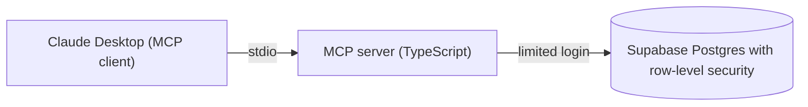

# Case Study: A Safe AI Assistant for Business Data

**A custom MCP server that lets Claude answer questions about a company database, and raise review flags that only a human can approve.**

> This repository documents the build. The source code is private. All data shown is fictional sample data.

---

## At a glance

| | |
|---|---|
| **Project** | Custom MCP server connecting Claude to a Postgres database |
| **Built by** | Queen Ikwuji, QueenEagleAI |
| **Stack** | TypeScript, Node.js, MCP TypeScript SDK, Supabase (Postgres), Zod, Claude Desktop |
| **Focus** | Giving AI access to business data without giving it too much power |
| **Data** | Fictional sample business data (customers, orders, invoices, support tickets) |

---

## The problem

Most business owners want to ask their AI assistant simple questions about their own data:

- Who owes us money?
- Which customers are waiting on support?
- Which orders need a second look?

The hard part is not getting AI to answer. The hard part is letting it near real company data safely. Too much access and one mistake, or one malicious instruction, can expose or change things nobody intended. Too little access and the assistant is useless.

## Why I built this

I received a job description for a Claude AI Automation Engineer role. It listed skills I had not yet used in production, including a custom MCP server over a PostgreSQL database with row-level security.

Instead of pretending, I built a small version of it myself. This case study documents that build, including the bugs and the security decisions.

---

## The solution

An MCP (Model Context Protocol) server is a small program that gives an AI assistant a defined set of tools. I built one that sits between Claude and a Postgres database, and I designed it so the database itself enforces the safety rules. Even if the AI or the code makes a mistake, the database refuses anything outside the permissions.

Claude can look things up, combine results across tools, and give practical advice. It can also raise a flag asking a person to review an order. It cannot change that order, and it cannot approve its own flag.

### Architecture

1. Claude Desktop starts the server on the local machine and talks to it through a standard input and output channel.
2. The server connects to the database with a restricted user, never the admin login.
3. The database decides what that user can read or write.

---

## What it can do

Four tools, three read-only and one narrow write action:

| Tool | Type | What it does |
|---|---|---|
| `find_customer` | Read-only | Finds a customer by company name, contact, or email, and shows which other systems (CRM, accounting, order system) they are linked to, with a match confidence score. |
| `get_overdue_invoices` | Read-only | Lists unpaid invoices past their due date, with days overdue and the total owed. |
| `list_open_tickets` | Read-only | Lists unresolved support tickets, highest priority first. |
| `flag_order_for_review` | Narrow write | Creates a pending review flag on an order. It never changes the order. |

### Example: one question, two tools

I asked: *"Which customers have both overdue invoices and open support tickets? Who should I contact first?"*

Claude chose the right tools by itself, combined the results, and advised calling the customer with the largest overdue invoice about their delayed shipment before asking for payment. That is the difference between a database lookup and a useful assistant.

### Example: the write tool with a human in the loop

When I asked Claude to flag an order, it created a pending flag and told me the order itself was not changed. A person then reviews the flag in the database and approves or dismisses it. The database records who decided and when.

---

## Data model

Designed around the idea of one unified business view, with customer matching across systems.

| Table | Purpose |
|---|---|
| Customers | One record per real-world customer, whichever systems they appear in. |
| Customer external IDs | Links each customer to their IDs in other systems, so the same customer is never duplicated. Re-running a sync cannot create duplicates. |
| Orders | Customer orders with status and totals. |
| Invoices | Invoices linked to customers and orders. Overdue status is calculated live, not stored. |
| Support tickets | Customer tickets with status and priority. |
| Order review flags | The only place the AI can write. Holds pending, approved, and dismissed review requests. |

---

## Security design

Security was the main learning goal. These are the decisions that matter most:

- **Least privilege.** The server uses a dedicated limited database user. It can read selected tables and nothing else.
- **Row-level security.** Security rules are on for every table. With no rule, the user sees nothing. Read access is granted explicitly.
- **A narrow write path.** The AI can only add a review flag with two fields filled in (the order and the reason). The database forces every new flag to start as pending.
- **Humans make the decision.** The AI cannot approve or dismiss flags and cannot edit orders. The database rejects both attempts.
- **No duplicate flags.** An order can have only one pending flag at a time.
- **Safe inputs.** Every tool validates what it receives, and database queries never mix user text into the command itself.
- **Safe errors.** Users see a plain message. The technical detail goes to a private log.
- **No secrets in the repository.** Credentials live outside the code and outside version control.
- **A second checkpoint.** Claude Desktop asks for permission before using a tool, and I keep the write tool on "allow once".

---

## Challenges and how I solved them

Real builds are messy. These are the problems that taught me the most.

**1. The assistant found nothing, with no error.**
Claude searched for a customer I could see in the database, and it reported no match. The cause was the security rules working as designed: the limited user had no permission to read yet, so the database returned zero rows silently. Once I added explicit read permissions, it worked. The lesson: when an AI tool says "nothing found", check what it is allowed to see before assuming the data is missing.

**2. The server was configured but invisible.**
Claude Desktop did not list my server even though my settings were saved. I had placed the server settings inside the wrong section of the configuration file. Moving them to the top level fixed it.

**3. Tools failed, then worked.**
Two lookups failed and then succeeded with no code changes. I made the errors temporarily visible to investigate, then traced it to an unstable internet connection, not the code. I then restored the safe, generic error messages so technical detail is never shown to users.

**4. A column that stayed empty.**
After a human approved a flag, the "resolved at" time was blank, because nothing filled it in. I fixed it with a database rule that stamps the time automatically whenever a flag leaves the pending state.

---

## Results

- Claude Desktop connected to a live database through a custom server I built.
- Four working tools, including one safe write action.
- Cross-tool questions answered in plain language with practical advice.
- Security tested on purpose: the limited user was blocked from changing orders and approving its own flags.

---

## What I would do next

Being honest about the limits of a learning project:

- **Separate logins for reading and writing**, so the read-only credential can never write.
- **Notes on existing flags**, so extra context can be added without creating duplicates.
- **Per-user data access**, so each person sees only the customers they own.
- **Stricter connection security** for production use.
- **Remote deployment**, for example on Azure with single sign-on and managed secrets.
- **Automated tests and sync workers** for systems like Salesforce and QuickBooks.
- **An automation layer**, for example an n8n workflow that uses overdue-invoice data to send escalating payment reminders.

---

## What this project shows

- Building and connecting a custom MCP server for Claude
- PostgreSQL schema design, migrations, and row-level security
- Designing AI access with least privilege and human approval
- Debugging real integration problems systematically
- Explaining technical work in plain language

---

## About the builder

I am **Queen Ikwuji**, an AI automation consultant and educator, and the founder of QueenEagleAI. I help businesses automate repetitive work with AI agents, workflows, and no-code tools such as n8n, Claude, and APIs. I also teach people how to build practical AI automations, with a background in HR recruitment and teaching that shapes how I explain technical work.

## Work with me

Want to automate repetitive work in your business, or build a safe AI assistant on top of your own data?

- **Book a call:** [Book an AI workflow discovery call](https://calendly.com/queenikwuji/ai-workflow-discovery-call)
- **LinkedIn:** [www.linkedin.com/in/queen-ikwuji-8b925524a](https://www.linkedin.com/in/queen-ikwuji-8b925524a)
- **Portfolio:** [queeneagleai-plum-iota.vercel.app](https://queeneagleai-plum-iota.vercel.app)

---

## License

Copyright (c) Queen Ikwuji. All rights reserved. This repository contains documentation only. The source code is private and is not licensed for reuse.
